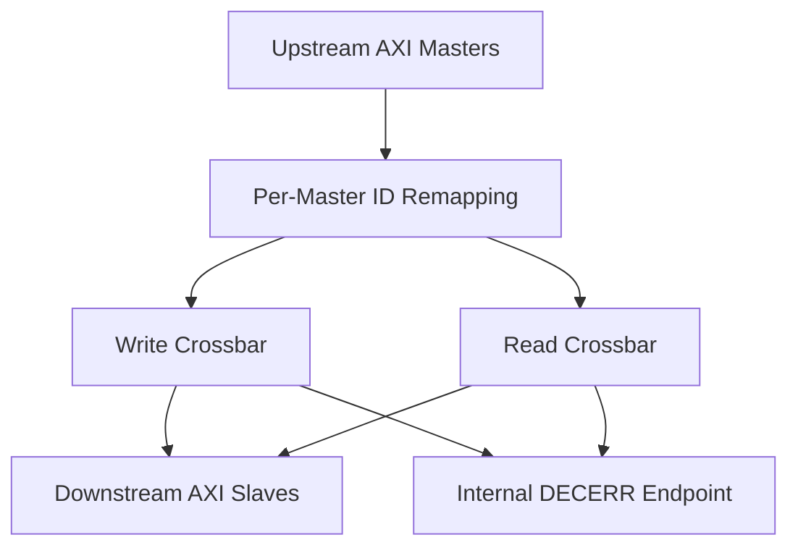

# AXI4 Interconnect — SystemVerilog

### A parameterized multi-master, multi-slave crossbar with outstanding transactions and burst support.


## Overview

This project implements an AXI4-style interconnect that connects multiple masters to multiple slaves through a configurable crossbar.

The interconnect routes requests according to an address map, arbitrates access when masters compete for the same slave, tracks outstanding transactions, and returns responses to the correct originating master.

The design includes independent read and write paths, transaction ID remapping, write-data ordering FIFOs, burst routing, and an internal error responder for unmapped addresses and INCR bursts that cross a 4 KB boundary.

**The supplied self-checking burst integration test passes in AMD Vivado/XSim.**

> This is a focused RTL implementation and verification project. A passing integration test is not a claim of exhaustive AXI4 compliance, synthesis closure, or FPGA hardware validation.

---

## What Problem Does It Solve?

A system may contain several request-generating components—such as processors, DMA engines, or accelerators—and several memory-mapped targets.

Those components need more than simple signal connections:

- Requests must reach the correct address region.
- Competing masters must share a target fairly.
- Write data must remain associated with the correct write address.
- Responses must return to their originating master.
- Identical transaction IDs from different masters must remain distinguishable.
- Multiple transactions may be in flight simultaneously.

This interconnect implements that routing and transaction-management layer.

```text
   AXI Master 0 ─────┐                         ┌───── AXI Slave 0
                    │                         │
   AXI Master 1 ─────┼──── AXI Crossbar ───────┼───── AXI Slave 1
                    │                         │
        ...         │                         │       ...
                    │                         │
   AXI Master N ─────┘                         └───── AXI Slave M
```

Masters accessing different targets have separate routing paths. Masters accessing the same target are handled by that destination's arbitration logic.

---

## Features

| Feature | Description |
|---|---|
| **Parameterized connectivity** | Configurable numbers of master and slave ports |
| **Configurable address map** | Base address and region size for each slave |
| **Independent read/write paths** | Separate crossbars for read and write traffic |
| **Round-robin arbitration** | Per-destination address arbitration with stalled-grant locking |
| **Multiple outstanding transactions** | Independent per-master limits for in-flight reads and writes |
| **ID remapping** | Master-index tagging prevents collisions between masters using the same local ID |
| **Same-ID ordering control** | An active ID cannot switch destinations until its earlier transactions retire |
| **Write-data ordering** | FIFOs preserve routing and ownership based on accepted AW order |
| **Burst routing** | Carries FIXED, INCR, and WRAP burst attributes |
| **4 KB boundary protection** | Detects crossing INCR bursts before they reach real slaves |
| **Error completion** | Internal DECERR endpoint completes unmapped and boundary-rejected requests |
| **Self-checking verification** | Reference-memory checks, directed tests, randomized traffic, and protocol assertions |

---

## Architecture



The diagram shows request routing. Write responses and read data return through their corresponding crossbar paths.

### Address Routing and Arbitration

Each master has a destination-routing stage that decodes its request address.

Each destination has its own arbitration stage that selects among competing masters. This avoids using one global address arbiter for all targets.

Unmapped requests and detected INCR boundary crossings are redirected to an additional internal error destination.

### Transaction ID Remapping

Different masters can issue the same local transaction ID. The interconnect distinguishes them by adding a master tag:

```text
Slave-facing ID = {master index, original transaction ID}
```

For example, with four masters and four-bit local IDs:

```text
Master 0, ID 3  →  00_0011
Master 1, ID 3  →  01_0011
Master 2, ID 3  →  10_0011
Master 3, ID 3  →  11_0011
```

The response routers use the upper bits to identify the originating master. The remapping stage then removes the tag and restores the original ID.

### Outstanding Transaction Tracking

The design counts a transaction as outstanding from:

- **Write:** accepted AW until accepted B.
- **Read:** accepted AR until the accepted RLAST beat.

Read and write counts are tracked independently.

Per-ID tables also record the active destination. Requests using the same ID cannot move to a different slave until the earlier transactions retire. Different IDs are not forced into one global completion order.

### Write-Data Ordering

AXI4 write data does not carry a WID field. Routing therefore depends on accepted write-address order.

The design uses:

1. A **per-master destination FIFO** to identify where that master's next W burst must go.
2. A **per-destination master FIFO** to identify which master supplies the next W burst.

FIFO entries are retired on the accepted WLAST beat.

### Error Handling

The internal error endpoint returns **DECERR** for:

- Addresses outside the configured map.
- INCR bursts detected as crossing a 4 KB boundary.

For rejected writes, it consumes the W burst before returning B. For rejected reads, it returns the requested number of R beats and asserts RLAST on the final beat.

---

## Project Structure

```text
axi4-interconnect/
├── rtl/
│   ├── common/
│   │   ├── axi_if.sv
│   │   ├── axi_addr_decoder.sv
│   │   ├── axi_arbiter_rr.sv
│   │   ├── axi_fifo.sv
│   │   ├── axi_outstanding_tracker.sv
│   │   ├── axi_4kb_check.sv
│   │   └── axi_burst_addr_gen.sv
│   │
│   ├── interconnect/
│   │   ├── axi_crossbar_top.sv
│   │   ├── axi_id_remap.sv
│   │   ├── axi_crossbar_write_ot.sv
│   │   ├── axi_crossbar_read_ot.sv
│   │   ├── axi_write_demux_ot.sv
│   │   ├── axi_write_mux_ot.sv
│   │   ├── axi_read_demux_ot.sv
│   │   └── axi_read_mux_ot.sv
│   │
│   └── models/
│       ├── axi_decode_error_slave.sv
│       └── axi_slave_burst.sv
│
├── tb/
│   ├── checkers/
│   │   └── axi_burst_protocol_checker.sv
│   └── integration/
│       └── axi_crossbar_burst_tb.sv
│
├── .gitignore
└── README.md
```

`_ot` identifies the outstanding-transaction-capable implementation.

### Main Modules

| Module | Responsibility |
|---|---|
| `axi_crossbar_top` | Integrates ID remapping, read/write crossbars, and the error endpoint |
| `axi_id_remap` | Adds master tags to request IDs and restores original response IDs |
| `axi_crossbar_write_ot` | Connects write-routing rows to destination arbitration columns |
| `axi_crossbar_read_ot` | Connects read-routing rows to destination arbitration columns |
| `axi_write_demux_ot` | Routes one master's write requests and data toward selected destinations |
| `axi_write_mux_ot` | Arbitrates write requests from multiple masters into one destination |
| `axi_read_demux_ot` | Routes one master's read requests and arbitrates returning read data |
| `axi_read_mux_ot` | Arbitrates read requests into one destination and routes responses by master tag |
| `axi_decode_error_slave` | Completes requests directed to the internal error port |
| `axi_slave_burst` | Burst-capable memory model used by the simulation |
| `axi_burst_protocol_checker` | Checks channel stability and known values |

**Core versus verification:** The crossbar uses 15 RTL files. The simulation additionally uses the burst memory slave, its address generator, the protocol checker, and the testbench.

Although stored under `rtl/models`, `axi_decode_error_slave` is required core RTL because the crossbar instantiates it internally.

---

## Configuration

The reusable design top is **`axi_crossbar_top`**.

| Parameter | Default | Purpose |
|---|---|---|
| `ADDR_WIDTH` | `32` | Address width |
| `DATA_WIDTH` | `32` | Data width |
| `ID_WIDTH` | `4` | Original master-side ID width |
| `NUM_MASTERS` | `4` | Number of upstream ports |
| `NUM_SLAVES` | `3` | Number of external downstream ports |
| `MAX_OUTSTANDING` | `4` | Per-master outstanding limit, applied separately to reads and writes |
| `SLAVE_BASE_ADDR` | All zero | Packed array of slave region bases |
| `SLAVE_ADDR_SIZE` | All zero | Packed array of region sizes in bytes |

Configure a nonempty address map before use. The zero-sized default regions do not map any real slave.

The internal error destination is additional to `NUM_SLAVES`.

### Interface Width Requirements

The slave-facing IDs include the master tag:

```text
MASTER_BITS = (NUM_MASTERS > 1) ? clog2(NUM_MASTERS) : 1
M_ID_WIDTH  = ID_WIDTH + MASTER_BITS
```

Therefore:

- Upstream interfaces use `ID_WIDTH`.
- Downstream interfaces use `M_ID_WIDTH`.

For the supplied two-master testbench, upstream IDs are four bits and downstream IDs are five bits.

All connected interfaces operate in the same clock/reset domain. Interface instances must be declared with matching widths; changing a module parameter does not resize interfaces declared by its parent.

---

## Verification

The integration testbench connects two traffic agents to two burst memory slaves through the crossbar.

Each agent maintains a byte-addressed reference memory to check writes and returned read data.

### Scenarios Exercised

- Concurrent traffic from both masters.
- FIXED, INCR, and WRAP bursts.
- Narrow transfers and unaligned first beats.
- Partial write strobes and readback checks.
- Legal bursts ending at a 4 KB boundary.
- Deliberate boundary-crossing reads and writes.
- Unmapped multi-beat requests.
- Readback after rejected writes.
- A legal 256-beat INCR transfer.
- Multiple accepted addresses before write-data completion.
- Same-ID requests blocked from switching destinations.
- Cross-slave completion ordering.
- Randomized delays and response backpressure.
- Outstanding-count range checks.

The test also checks that crossing requests never appear on real-slave address ports.

### Protocol Assertions

The checker monitors:

- VALID and payload stability while stalled.
- Unknown values on handshake signals.
- Unknown payload values while VALID is asserted.

It complements the scoreboard; it is not a complete AXI transaction-level protocol checker.

### Validation Status

The supplied burst integration simulation passes in **AMD Vivado/XSim**.

Broader regression, functional coverage closure, parameter sweeps, synthesis results, and hardware validation are not claimed.

---

## Run the Simulation

### Requirements

- AMD Vivado with XSim.
- SystemVerilog support.
- An installed target device for creating the Vivado project.

### Steps

1. Clone or download this repository.

   ```bash
   git clone https://github.com/reyan1144/axi4-interconnect.git
   cd axi4-interconnect
   ```

2. Create a project in Vivado.

3. Add all `.sv` files under `rtl/` as **Design Sources**.

4. Add all `.sv` files under `tb/` as **Simulation Sources**.

5. Confirm the files are recognized as **SystemVerilog** and enabled for simulation.

6. Set the simulation top to:

   ```text
   axi_crossbar_burst_tb
   ```

7. Launch **Behavioral Simulation** and select **Run All**.

The testbench prints a completion result and terminates on failure. A **20 ms simulated-time watchdog** catches hangs; a short fixed-duration GUI run may stop before completion.

> If Vivado reports that `axi_burst_protocol_checker` cannot be found, confirm that `tb/checkers/axi_burst_protocol_checker.sv` is included in the active simulation sources. Do not remove the checker instances to bypass the error.

---

## Scope and Limitations

- **Reduced AXI4 interface:** QoS, exclusive accesses/LOCK, CACHE, PROT, and related sideband attributes are not implemented.
- **Single clock domain:** Clock-domain crossing is outside the current design.
- **Open memory-model issue:** A concurrent write to a word presented on a stalled read can change the burst slave's RDATA. Holding offered read data in registers and adding a directed collision test remain necessary.
- **Burst legality:** The address generator does not reject FIXED bursts longer than 16 beats.
- **Address-map edges:** Decoder arithmetic needs overflow-safe handling for regions ending at the top of the address space.
- **Malformed writes:** Earlier accepted beats are not rolled back after a later WLAST error. The optional malformed-WLAST test expectation also needs correction before enabling that scenario.
- **Endpoint model:** The memory slave assumes power-of-two depth and indexes low address bits rather than performing general address-range validation.
- **Verification boundaries:** Full-depth saturation, broader parameter testing, and coverage closure remain open. Slaves that interleave different masters' read bursts between beats require further response-arbitration analysis and testing.

## Further Work

- Fix and verify stalled-read/concurrent-write behavior.
- Expand randomized ordering and outstanding-depth regression.
- Add functional coverage and parameterized test configurations.
- Report synthesis utilization and timing for a specified FPGA target.
